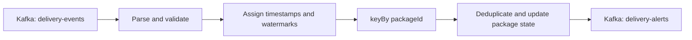

# Apache Flink for Kafka Users

## A practical tutorial: detect delayed locker deliveries

Kafka stores and transports an ordered event history. Flink continuously computes over that history while maintaining recoverable state.

This guide develops one concrete job:

> Emit an alert when a package has not reached its assigned locker within 30 minutes of going out for delivery.

Along the way, it explains:

- how Flink relates to Kafka;
- keyed state, event time, watermarks, and timers;
- where event-ID deduplication belongs;
- operators, subtasks, key groups, TaskManagers, and task slots;
- checkpointing and the limits of exactly-once processing;
- horizontal scaling and Kafka partition limits;
- why hot keys are special and how to handle them.

## Version used

As of November 2026, Flink 2.3.0 is the newest core release, but the currently published Kafka connector supports Flink 2.1.x and 2.2.x. This tutorial therefore uses:

```text
Apache Flink:          2.2.1
Flink Kafka connector: 5.0.0-2.2
Java:                  17
```

Check the [official Flink downloads](https://flink.apache.org/downloads/) and [Flink 2.2 Kafka connector documentation](https://nightlies.apache.org/flink/flink-docs-release-2.2/docs/connectors/datastream/kafka/) before starting a new project.

The code below is an implementation blueprint focused on Flink's important APIs and decisions. It omits imports, packaging, topic creation, and deployment commands rather than presenting itself as a complete sample repository.

## 1. The Kafka-to-Flink mental model

| Kafka idea | Flink counterpart |
|---|---|
| Topic | A common Flink source or sink |
| Partition | A source split consumed by a source subtask |
| Consumer application | A graph of Flink operators |
| Record key | Input to an explicit `keyBy(...)` operation |
| Materialized view | Flink managed keyed state |
| Consumer offset | One component of a Flink checkpoint |
| Kafka transaction | One possible part of an end-to-end exactly-once pipeline |
| Consumer rebalance | Flink rescaling, including redistribution of keyed state |

Two distinctions matter:

1. A Kafka record key does not automatically become the Flink state key. The job explicitly chooses its key with `keyBy(...)`.
2. A Flink checkpoint contains matching source positions and operator state. After a failure, Flink normally restores the Kafka positions from that checkpoint rather than treating separately committed consumer-group offsets as the complete recovery point.

Flink usually complements Kafka:

```text
Kafka: durable event log
Flink: continuous, stateful computation over the log
```

Flink managed state belongs to the running application. It is not a shared query database or the system of record for other services.

## 2. The delivery use case

The input topic is `delivery-events`. Records use `packageId` as their Kafka key so that events for a package stay in one Kafka partition and retain source order. This is an input contract: the job does not reconstruct an arbitrarily reordered package history.

```json
{
  "eventId": "evt-101",
  "packageId": "pkg-42",
  "attemptId": "attempt-9",
  "sequence": 17,
  "status": "OUT_FOR_DELIVERY",
  "eventTimeMs": 1793973600000
}
```

Later, the delivery platform may publish:

```json
{
  "eventId": "evt-102",
  "packageId": "pkg-42",
  "attemptId": "attempt-9",
  "sequence": 18,
  "status": "DELIVERED_TO_LOCKER",
  "eventTimeMs": 1793975040000
}
```

The monotonic `sequence` is per package. It lets the job reject a stale status, but it does not reorder history or reconstruct a missing earlier event. `eventId` identifies a single business event and remains stable across publisher and Kafka retries. `attemptId` identifies one delivery attempt and keeps repeated status messages from restarting that attempt's SLA.

The source deserializer should read both the Kafka key and payload and reject a key whose value does not match the payload `packageId`.

The output topic is `delivery-alerts`:

```json
{
  "alertId": "delayed:attempt-9",
  "packageId": "pkg-42",
  "outForDeliveryAtMs": 1793973600000,
  "deadlineMs": 1793975400000
}
```

Use a deterministic `alertId` so downstream consumers can make their own writes idempotent.

## 3. The job graph



Conceptually:

```text
KafkaSource
  -> parse and validate
  -> timestamps and watermarks
  -> keyBy(packageId)
  -> KeyedProcessFunction
       - MapState<eventId, seen>
       - ValueState<latestSequence>
       - ValueState<lastAttemptId>
       - ValueState<deadline>
       - one timer per active package
  -> KafkaSink
```

`keyBy(packageId)` is a network shuffle. After the shuffle, every event for one package is processed by the same logical state owner.

## 4. Project dependencies

The important Maven dependencies are:

```xml
<properties>
  <maven.compiler.release>17</maven.compiler.release>
  <flink.version>2.2.1</flink.version>
</properties>

<dependencies>
  <dependency>
    <groupId>org.apache.flink</groupId>
    <artifactId>flink-streaming-java</artifactId>
    <version>${flink.version}</version>
    <scope>provided</scope>
  </dependency>

  <dependency>
    <groupId>org.apache.flink</groupId>
    <artifactId>flink-clients</artifactId>
    <version>${flink.version}</version>
    <scope>provided</scope>
  </dependency>

  <dependency>
    <groupId>org.apache.flink</groupId>
    <artifactId>flink-connector-kafka</artifactId>
    <version>5.0.0-2.2</version>
  </dependency>

  <dependency>
    <groupId>org.apache.flink</groupId>
    <artifactId>flink-json</artifactId>
    <version>${flink.version}</version>
  </dependency>
</dependencies>
```

The Flink runtime dependencies are marked `provided` because the cluster supplies them. Package the Kafka connector, JSON format, and application classes in the submitted job JAR unless the deployment explicitly installs those artifacts on the cluster classpath. Follow Flink's [program packaging guidance](https://nightlies.apache.org/flink/flink-docs-release-2.2/docs/dev/configuration/overview/#program-packaging-and-distributed-execution) for the chosen deployment.

## 5. Create the Kafka source and assign event time

```java
KafkaSource<DeliveryEnvelope> source =
        KafkaSource.<DeliveryEnvelope>builder()
                .setBootstrapServers("localhost:9092")
                .setTopics("delivery-events")
                .setGroupId("delayed-delivery-detector")
                .setStartingOffsets(OffsetsInitializer.earliest())
                .setDeserializer(new DeliveryEnvelopeDeserializationSchema())
                .build();

WatermarkStrategy<DeliveryEnvelope> sourceWatermarks =
        new ValidDeliveryWatermarkStrategy(
                Duration.ofMinutes(2),
                Duration.ofMinutes(1));

DataStream<DeliveryEnvelope> decoded =
        env.fromSource(source, sourceWatermarks, "delivery-events")
                .uid("delivery-events-source");

SingleOutputStreamOperator<DeliveryEvent> events =
        decoded
                .process(new RouteValidAndInvalidEvents(INVALID_EVENTS))
                .uid("route-valid-and-invalid-delivery-events");
```

`DeliveryEnvelopeDeserializationSchema` is an application `KafkaRecordDeserializationSchema` that reads the Kafka key and value, parses the JSON, and returns either a valid event or an invalid envelope containing the raw record and error. `ValidDeliveryWatermarkStrategy` assigns timestamps and advances watermarks only from valid envelopes; invalid timestamps cannot fire timers. It also implements validity-aware idleness, so malformed traffic does not keep a partition active forever. Because the strategy is attached through `fromSource`, Kafka applies it per source partition before merging watermarks. `RouteValidAndInvalidEvents` emits valid `DeliveryEvent` values on the main output and sends invalid envelopes to the `INVALID_EVENTS` side output for a dead-letter sink.

Those three small application classes are left out of this conceptual guide, but their order is important: parse and validate at the source boundary, derive source-partition watermarks only from valid records, then route invalid records away before `keyBy`.

The starting-offset setting applies when the job has no restorable Flink state. Recovery normally uses the source positions stored in the latest checkpoint.

### What a watermark means

A watermark of `14:29` means approximately:

> The source believes event time has progressed to 14:29, and events earlier than that are now considered late according to this job's policy.

It is not a guarantee that an older record can never arrive.

Example, with arrival time separated from the timestamp carried by each event:

```text
arrival time | event time | event
-------------|------------|---------------------------------------
14:00:01     | 14:00      | pkg-42 OUT_FOR_DELIVERY
14:31:00     | 14:31      | unrelated traffic advances event time
14:31:05     | 14:24      | pkg-42 DELIVERED_TO_LOCKER arrives late
```

With an assumed two-minute out-of-orderness bound, the watermark associated with traffic at `14:31` is roughly `14:29`. The `14:30` deadline has not fired, so the late-arriving `14:24` delivery can still cancel it. A `KeyedProcessFunction` does not automatically drop records beyond this bound; the application must define its late-event policy.

Kafka source watermarks are calculated per partition and merged downstream. A quiet partition can hold back the merged watermark, so the custom strategy's validity-aware idleness timeout prevents an idle or invalid-only partition from blocking all event-time progress. For ordinary already-validated streams, Flink's built-in `.withIdleness(...)` wrapper is sufficient. See [Flink watermark generation](https://nightlies.apache.org/flink/flink-docs-release-2.2/docs/dev/datastream/event-time/generating_watermarks/).

## 6. Choose the Flink key

```java
DataStream<DeliveryAlert> alerts =
        events
                .keyBy(event -> event.packageId)
                .process(new DelayedDeliveryDetector(
                        Duration.ofMinutes(30),
                        Duration.ofDays(7)))
                .name("delayed-delivery-detector")
                .uid("delayed-delivery-detector")
                .setParallelism(16)
                .setMaxParallelism(128);
```

`keyBy(packageId)` ensures that all state and timers for a package are accessed serially by one detector subtask. The subtask still handles many different package IDs.

## 7. Deduplicate before applying business effects

There are two valid layouts.

### Recommended for this package state machine

Key by `packageId`, then check `eventId` inside the package-keyed process function before changing the package state:

```text
keyBy(packageId)
  -> check seenEventIds[eventId]
  -> apply package transition
```

All legitimate copies of an event should have the same package ID. This layout:

- deduplicates before business state changes or alerts;
- keeps package events in one keyed operator;
- avoids a second network shuffle;
- makes per-package ordering easier to reason about.

### Separate global deduplication stage

If the system must detect an `eventId` reused with different package IDs, use:

```text
keyBy(eventId)
  -> deduplicate
  -> keyBy(packageId)
  -> package state machine
```

This enforces global event-ID uniqueness, but it adds a stateful stage and a second shuffle. Different events for the same package travel through different dedup subtasks, so the package stage must tolerate reordering, normally through a package sequence or version.

An event ID associated with two different packages should usually be rejected as invalid producer data rather than silently accepted.

### Why checkpointing is not business deduplication

Flink checkpoints prevent failure recovery from incorrectly applying the same source progress to a different state snapshot. They do not remove two distinct Kafka records that a publisher emitted with the same business `eventId`.

Event-ID deduplication protects against:

- publisher retries;
- duplicate writes to Kafka;
- manual replay;
- backfills containing records already processed.

### Bound deduplication state with TTL

Deduplication state cannot grow forever. Configure a TTL longer than the maximum duplicate, replay, or backfill horizon.

Important TTL behavior:

- map entries can expire independently;
- TTL uses processing time;
- cleanup is best effort, so expired values may remain physically stored for a while;
- after an ID expires, the event-ID check can accept that ID again;
- TTL is a memory policy, not a permanent uniqueness guarantee.

The sequence tombstone in the example can still reject an expired old event until that tombstone also expires. Once both protections expire, a sufficiently old replay can be processed again. If a monotonic per-package sequence is authoritative, retaining the newest sequence can be cheaper and stronger than retaining a long history of event IDs. See [Flink state TTL](https://nightlies.apache.org/flink/flink-docs-release-2.2/docs/dev/datastream/fault-tolerance/state/).

## 8. Implement the keyed state machine

The following code deliberately uses event-time deadlines. Section 9 explains when a wall-clock design should use processing time instead. Imports and connector construction are omitted for clarity. `RECONCILIATION_EVENTS` is an `OutputTag<DeliveryEvent>` connected to a durable review or reconciliation topic for transitions that violate the one-active-attempt contract.

```java
public static final class DelayedDeliveryDetector
        extends KeyedProcessFunction<String, DeliveryEvent, DeliveryAlert> {

    private final long slaMs;
    private final Duration replayRetention;

    private transient MapState<String, Boolean> seenEventIds;
    private transient ValueState<Long> latestSequence;
    private transient ValueState<String> lastAttemptId;
    private transient ValueState<String> activeAttemptId;
    private transient ValueState<Long> outForDeliveryAt;
    private transient ValueState<Long> deadline;

    public DelayedDeliveryDetector(Duration sla, Duration replayRetention) {
        this.slaMs = sla.toMillis();
        this.replayRetention = replayRetention;
    }

    @Override
    public void open(OpenContext context) throws Exception {
        StateTtlConfig ttl =
                StateTtlConfig.newBuilder(replayRetention)
                        .setUpdateType(
                                StateTtlConfig.UpdateType.OnCreateAndWrite)
                        .setStateVisibility(
                                StateTtlConfig.StateVisibility.NeverReturnExpired)
                        .build();

        MapStateDescriptor<String, Boolean> seenDescriptor =
                new MapStateDescriptor<>(
                        "seen-event-ids", String.class, Boolean.class);
        seenDescriptor.enableTimeToLive(ttl);
        seenEventIds = getRuntimeContext().getMapState(seenDescriptor);

        ValueStateDescriptor<Long> sequenceDescriptor =
                new ValueStateDescriptor<>("latest-sequence", Long.class);
        sequenceDescriptor.enableTimeToLive(ttl);
        latestSequence = getRuntimeContext().getState(sequenceDescriptor);

        ValueStateDescriptor<String> attemptDescriptor =
                new ValueStateDescriptor<>("last-attempt-id", String.class);
        attemptDescriptor.enableTimeToLive(ttl);
        lastAttemptId = getRuntimeContext().getState(attemptDescriptor);

        activeAttemptId = getRuntimeContext().getState(
                new ValueStateDescriptor<>("active-attempt-id", String.class));
        outForDeliveryAt = getRuntimeContext().getState(
                new ValueStateDescriptor<>("out-for-delivery-at", Long.class));
        deadline = getRuntimeContext().getState(
                new ValueStateDescriptor<>("deadline", Long.class));
    }

    @Override
    public void processElement(
            DeliveryEvent event,
            Context ctx,
            Collector<DeliveryAlert> out) throws Exception {

        // Schema validation should route malformed records to a dead-letter
        // output before keyBy. Keep this guard so an unknown high sequence
        // cannot suppress later valid events.
        if (event.eventId == null
                || event.attemptId == null
                || !isSupportedStatus(event.status)) {
            return;
        }

        if (seenEventIds.contains(event.eventId)) {
            return;
        }

        Long currentSequence = latestSequence.value();
        if (currentSequence != null && event.sequence <= currentSequence) {
            return;
        }

        Long currentDeadline = deadline.value();

        if ("OUT_FOR_DELIVERY".equals(event.status)) {
            String previousAttempt = lastAttemptId.value();

            if (event.attemptId.equals(previousAttempt)) {
                // The same active or completed attempt never starts a new SLA.
                seenEventIds.put(event.eventId, true);
                if (currentDeadline != null) {
                    latestSequence.update(event.sequence);
                }
                return;
            }

            if (currentDeadline != null) {
                // Do not mark it seen until reconciliation handles it.
                ctx.output(RECONCILIATION_EVENTS, event);
                return;
            }

            seenEventIds.put(event.eventId, true);
            latestSequence.update(event.sequence);
            lastAttemptId.update(event.attemptId);
            long newDeadline = event.eventTimeMs + slaMs;

            if (newDeadline <= ctx.timerService().currentWatermark()) {
                out.collect(newAlert(
                        event.attemptId,
                        ctx.getCurrentKey(),
                        event.eventTimeMs,
                        newDeadline));
                return;
            }

            activeAttemptId.update(event.attemptId);
            outForDeliveryAt.update(event.eventTimeMs);
            deadline.update(newDeadline);
            ctx.timerService().registerEventTimeTimer(newDeadline);
            return;
        }

        if ("DELIVERED_TO_LOCKER".equals(event.status)
                || "CANCELLED".equals(event.status)) {

            String currentAttempt = activeAttemptId.value();
            if (currentAttempt != null
                    && !event.attemptId.equals(currentAttempt)) {
                // Do not mark it seen until reconciliation handles it.
                ctx.output(RECONCILIATION_EVENTS, event);
                return;
            }

            seenEventIds.put(event.eventId, true);
            // Retain a compact terminal tombstone for the replay horizon.
            latestSequence.update(event.sequence);
            lastAttemptId.update(event.attemptId);

            if (currentDeadline == null) {
                return;
            }

            ctx.timerService().deleteEventTimeTimer(currentDeadline);

            if ("DELIVERED_TO_LOCKER".equals(event.status)
                    && event.eventTimeMs > currentDeadline) {
                out.collect(newAlert(
                        currentAttempt,
                        ctx.getCurrentKey(),
                        outForDeliveryAt.value(),
                        currentDeadline));
            }

            clearPending();
        }
    }

    @Override
    public void onTimer(
            long timestamp,
            OnTimerContext ctx,
            Collector<DeliveryAlert> out) throws Exception {

        Long expectedDeadline = deadline.value();
        if (expectedDeadline != null
                && expectedDeadline.longValue() == timestamp) {
            out.collect(newAlert(
                    activeAttemptId.value(),
                    ctx.getCurrentKey(),
                    outForDeliveryAt.value(),
                    timestamp));
            clearPending();
        }
    }

    private DeliveryAlert newAlert(
            String attemptId,
            String packageId,
            long startedAt,
            long deadlineAt) {
        return new DeliveryAlert(
                "delayed:" + attemptId,
                packageId,
                startedAt,
                deadlineAt);
    }

    private boolean isSupportedStatus(String status) {
        return "OUT_FOR_DELIVERY".equals(status)
                || "DELIVERED_TO_LOCKER".equals(status)
                || "CANCELLED".equals(status);
    }

    private void clearPending() throws Exception {
        activeAttemptId.clear();
        outForDeliveryAt.clear();
        deadline.clear();
    }
}
```

Example event and alert types:

```java
public static class DeliveryEvent {
    public String eventId;
    public String packageId;
    public String attemptId;
    public long sequence;
    public String status;
    public long eventTimeMs;

    public DeliveryEvent() {}
}

public static class DeliveryAlert {
    public String alertId;
    public String packageId;
    public long outForDeliveryAtMs;
    public long deadlineMs;

    public DeliveryAlert() {}

    public DeliveryAlert(
            String alertId,
            String packageId,
            long outForDeliveryAtMs,
            long deadlineMs) {
        this.alertId = alertId;
        this.packageId = packageId;
        this.outForDeliveryAtMs = outForDeliveryAtMs;
        this.deadlineMs = deadlineMs;
    }
}
```

The timer callback checks the stored deadline before emitting. That protects against a callback for a timer the state machine has already cancelled or replaced.

The TTL-bound `lastAttemptId` tombstone prevents a completed or alerted attempt from starting a second SLA during the replay-retention window. The example emits a one-time delayed alert. A production notification lifecycle may instead retain `alerted = true` and emit an `ALERT_RESOLVED` record when the eventual delivery arrives. This example treats cancellation as terminating the SLA without a delayed-delivery alert, even when the cancellation's event timestamp is after the deadline; change that branch if the business policy differs.

## 9. Event-time timer or processing-time timer?

This is a product decision.

### Event time

```java
ctx.timerService().registerEventTimeTimer(event.eventTimeMs + slaMs);
```

This means:

> Evaluate the deadline using the time recorded in the business event.

Advantages:

- deterministic during replay and backfill;
- lets deadlines wait for bounded event-time disorder across the input; it does not reorder a package's lifecycle history;
- matches a business SLA defined from the event timestamp.

Limitation: an event-time timer fires only when the watermark passes it. One idle partition can be handled with idleness detection, but if every input becomes idle, event time may stop and the timer may not fire promptly.

### Processing time

```java
long processingDeadline =
        ctx.timerService().currentProcessingTime() + slaMs;
processingDeadlineState.update(processingDeadline);
ctx.timerService().registerProcessingTimeTimer(processingDeadline);

// When a terminal event is processed before the callback:
ctx.timerService().deleteProcessingTimeTimer(processingDeadline);
```

This means:

> Alert 30 minutes after Flink observes the event.

Advantages:

- behaves like a live wall-clock alarm;
- does not need future events to advance a watermark.

Tradeoff: replay and backfill timing depends on when Flink processes the record. If the job is down past a checkpointed processing-time deadline, overdue timers may fire soon after recovery and create an alert burst.

These lines are not a drop-in replacement for the event-time registration in section 8. A processing-time implementation must consistently use a processing-time deadline state, `registerProcessingTimeTimer`, `deleteProcessingTimeTimer`, and wall-clock arrival semantics. It should not compare the business event timestamp with that stored processing-time deadline.

For a live operations SLA, processing time or a dedicated wall-clock watchdog is often the safer choice. For deterministic analytics and replay, event time is usually more appropriate. Some systems deliberately use both.

See [Flink process functions and timers](https://nightlies.apache.org/flink/flink-docs-release-2.2/docs/dev/datastream/operators/process_function/).

## 10. Configure checkpointing and the Kafka sink

```java
Configuration checkpointConfiguration = new Configuration();
checkpointConfiguration.set(
        CheckpointingOptions.CHECKPOINT_STORAGE,
        "filesystem");
checkpointConfiguration.set(
        CheckpointingOptions.CHECKPOINTS_DIRECTORY,
        "s3://my-flink-checkpoints/delayed-delivery/");

StreamExecutionEnvironment env =
        StreamExecutionEnvironment.getExecutionEnvironment();
env.configure(checkpointConfiguration);

env.enableCheckpointing(10_000);
```

Production checkpoints must live in durable shared storage. Every JobManager and TaskManager must be able to access the path. An `s3://` path also requires the matching Flink S3 filesystem plugin on the cluster. See [Flink checkpoint storage](https://nightlies.apache.org/flink/flink-docs-release-2.2/docs/ops/state/checkpoints/).

An exactly-once Kafka sink looks like:

```java
KafkaSink<DeliveryAlert> sink =
        KafkaSink.<DeliveryAlert>builder()
                .setBootstrapServers("localhost:9092")
                .setRecordSerializer(
                        KafkaRecordSerializationSchema
                                .<DeliveryAlert>builder()
                                .setTopic("delivery-alerts")
                                .setKeySerializationSchema(
                                        alert -> alert.packageId.getBytes(
                                                StandardCharsets.UTF_8))
                                .setValueSerializationSchema(
                                        new JsonSerializationSchema<>())
                                .build())
                .setDeliveryGuarantee(DeliveryGuarantee.EXACTLY_ONCE)
                .setTransactionalIdPrefix("delayed-delivery-prod-")
                .build();

alerts.sinkTo(sink).uid("delivery-alerts-sink");
```

Exactly-once has a boundary:

- Flink can restore its managed state and Kafka source positions consistently.
- `KafkaSink` can commit output through Kafka transactions.
- Downstream consumers must read with `isolation.level=read_committed`.
- Output is not visible until the checkpoint commits.
- The transactional ID prefix must be stable and unique for each independently running job.
- Kafka's transaction timeout must exceed the worst expected checkpoint and restart duration.
- An arbitrary HTTP request or database update does not automatically participate in a Flink checkpoint transaction. Use an idempotent write, a compatible transactional sink, or emit a command to Kafka and perform the side effect downstream.

Exactly-once recovery also does not remove producer-created duplicate business events; that is why the job still checks `eventId`.

See the [Flink 2.2 Kafka connector fault-tolerance documentation](https://nightlies.apache.org/flink/flink-docs-release-2.2/docs/connectors/datastream/kafka/) and [Flink 2.2 fault-tolerance guarantees](https://nightlies.apache.org/flink/flink-docs-release-2.2/docs/connectors/datastream/guarantees/).

## 11. How keys map to subtasks

Flink does not create one subtask per unique key.

Suppose:

```text
10,000,000 package IDs
detector parallelism = 4
maximum parallelism = 128
```

Flink creates four detector subtasks. Each subtask owns many keys.

The mapping is conceptually:

```text
packageId
  -> hash
  -> one of 128 key groups
  -> one of 4 detector subtasks
```

For example:

```text
pkg-42
  -> key group 73
  -> detector subtask 2
```

All state and timers for `pkg-42` live with subtask 2. Subtask 2 also processes many other packages.

Definitions:

- **Operator:** the logical operation, such as `DelayedDeliveryDetector`.
- **Subtask:** one parallel instance of an operator.
- **Parallelism:** the number of subtasks for that operator.
- **Key group:** the atomic unit used to assign and redistribute keyed state.
- **Maximum parallelism:** the number of key groups and the upper bound on future operator parallelism.

When the operator is rescaled, keys stay in their original key groups while Flink reassigns groups to a different number of subtasks. [Flink's stateful processing documentation](https://nightlies.apache.org/flink/flink-docs-release-2.2/docs/concepts/stateful-stream-processing/) describes keyed state as an embedded key/value store partitioned together with the stream.

Set maximum parallelism deliberately before production. Changing it for existing state can make restore incompatible, while setting it unnecessarily high adds overhead. See [Flink 2.2 parallel execution](https://nightlies.apache.org/flink/flink-docs-release-2.2/docs/dev/datastream/execution/parallel/).

## 12. Does each subtask get its own server?

No. The runtime hierarchy is:

```text
Server, VM, pod, or container host
└── TaskManager worker process
    ├── task slot
    │   └── task(s), each containing one or more chained subtasks
    └── task slot
        └── task(s), each containing one or more chained subtasks
```

A Flink deployment has:

```text
JobManager
  - schedules tasks
  - coordinates checkpoints
  - coordinates recovery

TaskManagers
  - execute subtasks
  - hold local managed state
  - exchange shuffled records
```

A TaskManager is a worker JVM and can execute multiple subtasks in separate threads. Task slots are Flink's scheduling and managed-memory sharing unit; they do not provide hard CPU isolation.

Operators that run consecutively can be chained into one task and thread. A shuffle such as `keyBy` creates an execution boundary.

With default slot sharing, one slot can contain a pipeline of subtasks from the same job. A job often needs approximately as many slots as its highest operator parallelism, rather than the sum of every operator's parallelism.

Example:

```text
3 TaskManagers x 4 slots = 12 slots
detector parallelism     = 12 subtasks
```

The scheduler distributes those 12 subtasks across the available TaskManagers. Several subtasks can share one TaskManager and physical server. One slot per TaskManager gives stronger JVM isolation; several slots per TaskManager reduce JVM and network overhead.

See the official [Flink 2.2 architecture](https://nightlies.apache.org/flink/flink-docs-release-2.2/docs/concepts/flink-architecture/).

## 13. How to scale the job

There are separate scaling controls:

| Change | What it provides |
|---|---|
| Add TaskManagers, CPU, memory, or slots | More cluster capacity |
| Increase an operator's parallelism | More concurrent instances of that operator |
| Add Kafka partitions | More potential Kafka source parallelism |
| Increase sink capacity | Prevents the sink from limiting the pipeline |

Adding servers without increasing operator parallelism may leave the new capacity unused. Raising parallelism without enough slots leaves work waiting for resources.

### Scale from the bottleneck

1. Find where backpressure begins: source, transformation, keyed operator, or sink.
2. Compare records per second, busy time, and backpressure across subtasks.
3. Increase the bottleneck operator's parallelism.
4. Add matching TaskManager slots, CPU, and memory.
5. If the Kafka source is limiting throughput, plan a safe Kafka partition expansion or a migration to a larger topic.
6. Rescale the stateful job from a savepoint or through the chosen adaptive or managed scaling mechanism.

Example:

```java
env.setParallelism(8);

events
    .keyBy(event -> event.packageId)
    .process(new DelayedDeliveryDetector(...))
    .setParallelism(32)
    .setMaxParallelism(128);
```

With 12 Kafka partitions:

- source parallelism 4 lets each source subtask read roughly three partitions;
- source parallelism above 12 leaves some source subtasks without a partition;
- the detector can still run at parallelism 32 because `keyBy` redistributes records after the source;
- total ingestion remains partly bounded by the 12 Kafka partitions.

Changing a Kafka topic's partition count can change the partition selected for an existing package key. Old records can remain in the original partition while new records go to another one, weakening the per-package source-order contract during the transition. Use the package sequence to reject stale transitions, and plan a controlled migration or a new topic if strict ordering is required; a sequence guard cannot reconstruct a missing earlier transition.

### Stateful rescaling

If detector parallelism changes from 4 to 8:

```text
Before: 128 key groups / 4 subtasks ≈ 32 groups per subtask
After:  128 key groups / 8 subtasks ≈ 16 groups per subtask
```

Flink restores from a checkpoint or savepoint and moves key groups, including their state and timers, to the new subtasks. Scaling is not instantaneous: tasks restart, network routes change, and state may need to move or restore.

Use stable `.uid(...)` values so Flink can map saved state back to the correct operators after a code change.

Manual rescaling through a savepoint is the straightforward baseline. The Adaptive Scheduler, Reactive Mode, a managed Flink platform, or the Flink Kubernetes Operator can automate parts of the process, subject to their deployment constraints. See [Flink 2.2 elastic scaling](https://nightlies.apache.org/flink/flink-docs-release-2.2/docs/deployment/elastic_scaling/) and the [Flink Kubernetes Operator autoscaler](https://nightlies.apache.org/flink/flink-kubernetes-operator-docs-stable/docs/managing/autoscaler/).

## 14. Hot keys

A hot key receives much more work than other keys:

```text
subtask 0:  5,000 events/s
subtask 1:  5,300 events/s
subtask 2: 75,000 events/s  <- one hot key
subtask 3:  4,900 events/s
```

All events for a keyed state machine must reach one state owner. Increasing parallelism redistributes different keys, but it cannot divide one key across subtasks while preserving ordinary per-key state and ordering.

`rebalance()` before `keyBy()` does not solve this. The later `keyBy()` sends the hot key back to a single subtask.

### 14.1 Choose the smallest correct key

For package lifecycle state, `packageId` is a good key. Broader keys such as `regionId`, `warehouseId`, or `lockerId` can concentrate unrelated entities on one subtask.

One package should rarely be legitimately hot. A hot package often indicates:

- a producer retry storm;
- duplicate events;
- malformed or abusive traffic;
- blocking work in `processElement`;
- an incorrectly broad key.

Package-keyed deduplication avoids repeated business effects, but every duplicate still reaches that package's subtask. A producer, gateway, or separate event-ID-keyed stage must rate-limit or absorb a retry storm before it can protect that subtask from the traffic itself.

### 14.2 Salt mergeable aggregations

Counts, sums, minimums, maximums, and mergeable sketches can use two-stage aggregation.

Suppose one large locker hub is a hot key for an hourly parcel count. Instead of immediately aggregating by `lockerId`, derive a deterministic shard:

```text
shard = hash(eventId) mod 16
```

Then run:

```text
keyBy(lockerId, shard)
  -> partial window aggregate
  -> keyBy(lockerId)
  -> merge 16 partial aggregates
```

```text
locker-hub-A#0  --\
locker-hub-A#1  ----> merge partial results -> hub A total
...              --/
locker-hub-A#15 --/
```

The final merger now receives a small number of partial results instead of every raw event. The tradeoff is another shuffle, extra state, and some additional latency. Use a deterministic shard so retries route consistently.

Flink SQL can apply a related local-global, two-phase aggregation optimization. See [Flink performance tuning](https://nightlies.apache.org/flink/flink-docs-release-2.2/docs/dev/table/tuning/).

### 14.3 Do not casually salt an ordered state machine

Package status, deduplication, and timers require one coherent state owner. Arbitrarily splitting one package can produce conflicting transitions and duplicate timers.

For a non-mergeable hot state machine, options include:

- redesign the key around truly independent subentities;
- model independent partial state plus a smaller coordinator;
- coalesce redundant updates;
- rate-limit the noisy source;
- isolate exceptional tenants or keys in a dedicated topic, job, or resource pool;
- move slow external calls out of `processElement` and use an appropriate asynchronous or message-driven boundary.

Async I/O helps when external latency is the bottleneck. It does not divide the CPU and state work for a single hot key.

## 15. Failure recovery and savepoints

A checkpoint captures a consistent combination of:

```text
Kafka source positions
+ operator state
+ pending timers
+ participating sink state
```

If a TaskManager fails, Flink restores the latest successful checkpoint and replays Kafka from the matching positions. State and source progress move back together.

Use:

- **checkpoints** for automatic failure recovery;
- **savepoints** for controlled upgrades, planned stops, and manual rescaling.

Checkpointing is disabled by default. Enable it explicitly and monitor checkpoint duration and failures. [Flink's stateful processing documentation](https://nightlies.apache.org/flink/flink-docs-release-2.2/docs/concepts/stateful-stream-processing/) explains how replay and checkpointing combine to provide consistent recovery.

## 16. What to monitor

Monitor the whole pipeline and compare metrics per subtask:

- Kafka consumer lag;
- records in and out per second;
- `busyTimeMsPerSecond`;
- backpressured time;
- idle time;
- current input watermark and watermark lag;
- late-event count;
- state size and growth;
- number of active timers;
- checkpoint duration, size, and failure count;
- restart and recovery duration;
- sink latency and Kafka transaction failures.

Large differences between subtasks often reveal skew. Uniformly busy subtasks suggest that ordinary scale-out may help. One saturated subtask with quiet peers suggests a hot key or uneven Kafka partitions.

## 17. Experiments that prove the design

Run these cases before treating the job as production-ready:

1. Send `OUT_FOR_DELIVERY`, then an on-time delivery. Expect no alert.
2. Send `OUT_FOR_DELIVERY` without delivery, then advance event time beyond the deadline. Expect one alert.
3. Send unrelated later-timestamp traffic before an on-time delivery arrives, while preserving `OUT_FOR_DELIVERY` before `DELIVERED_TO_LOCKER` for that package. Expect no alert while the delivery is inside the watermark allowance.
4. Repeat the same `eventId`. Expect no state transition or deadline change.
5. Repeat `OUT_FOR_DELIVERY` for the same `attemptId` with a new event ID and higher sequence. Expect the original deadline to remain unchanged.
6. Send a repeated status with a different event ID but an older sequence. Expect it to be ignored.
7. Send a delivery whose event timestamp is after the deadline. Expect a delayed alert even if the timer has not fired yet.
8. Stop and restart the job after a completed checkpoint. Expect the pending state and timer to survive.
9. Rescale from parallelism 2 to 4. Expect keyed state to follow its key groups.
10. Leave one Kafka partition idle. Expect other partitions' watermarks to progress after the configured idleness timeout.
11. Make every partition idle. Observe that an event-time timer does not behave like an independent wall-clock alarm.
12. Flood one package ID. Observe one detector subtask become hot.
13. Slow the sink. Observe backpressure propagate upstream.

## 18. Common misconceptions

### “Flink replaces Kafka”

Kafka retains and transports the log. Flink executes the continuous computation. They are commonly used together.

### “`keyBy` just follows Kafka partitions”

`keyBy` is a Flink repartitioning operation. It explicitly defines the key used to colocate records and managed state.

### “Flink state is a shared database”

Managed state belongs to an operator and is accessed through the current stream key. Treat it as recoverable processing state rather than a public query store or system of record.

### “There is one subtask per unique key”

An operator has a fixed number of subtasks. Each subtask processes many keys.

### “Each subtask has its own server”

Several subtasks can share a TaskManager JVM and physical server. Placement depends on task slots, slot sharing, and available resources.

### “Exactly once removes duplicate business events”

Exactly-once recovery coordinates source progress, state, and participating sinks. Producer-created duplicates still need business deduplication.

### “Exactly once includes any HTTP or database call”

An external side effect must participate in the checkpoint protocol or be made idempotent. Arbitrary calls are not automatically transactional with Flink.

### “A watermark proves no older event will arrive”

A watermark expresses the job's chosen lateness policy. Older events can still arrive afterward.

### “An event-time timer is a wall-clock alarm”

It fires when the watermark passes its timestamp. A fully quiet input can delay it indefinitely.

### “More subtasks solve every hot key”

More subtasks distribute different keys. A single key remains owned by one subtask unless the algorithm and data model are changed.

## 19. Production checklist

- [ ] Kafka records use `packageId` as their key.
- [ ] Events have a stable `eventId`, delivery `attemptId`, and monotonic package sequence or version.
- [ ] The producer preserves per-package sequence order, or the job explicitly buffers and reconstructs history.
- [ ] Deduplication happens before business effects.
- [ ] Dedup TTL exceeds the intended replay horizon.
- [ ] The behavior after TTL expiry is acceptable.
- [ ] Event time versus processing time is an explicit product choice.
- [ ] Watermark delay comes from measured out-of-order behavior.
- [ ] Idle Kafka partitions are handled.
- [ ] Late-delivery and alert-resolution policies are defined.
- [ ] Checkpointing is enabled with durable shared storage.
- [ ] Operators have stable UIDs.
- [ ] Maximum parallelism is chosen before state becomes durable.
- [ ] Kafka sink delivery guarantees are configured intentionally.
- [ ] Exactly-once consumers use `read_committed`.
- [ ] Transaction timeout exceeds the maximum checkpoint and restart window.
- [ ] HTTP and database side effects are idempotent or decoupled through Kafka.
- [ ] Malformed input goes to a dead-letter topic or controlled error path.
- [ ] Kafka partitions, source parallelism, operator parallelism, and slots are sized together.
- [ ] Kafka partition expansion has a migration plan for package ordering.
- [ ] Metrics reveal backpressure, checkpoint health, watermark lag, state growth, and skew.
- [ ] Restart, replay, rescaling, duplicate, late-event, idle-input, and hot-key cases have been load-tested.

## 20. Summary

The complete mental model is:

```text
Kafka partitions provide parallel, replayable input.

Flink operators form a distributed job graph.

keyBy(packageId) sends each package to one logical state owner.

Each operator has a fixed number of subtasks, and each subtask owns many keys.

Key groups make keyed state redistributable during rescaling.

TaskManagers host subtasks in task slots; a subtask does not inherently get a server.

Checkpoints bind Kafka positions, state, and timers into a consistent recovery point.

Event-ID deduplication handles producer duplicates; exactly-once recovery does not replace it.

Watermarks drive event-time timers; processing-time timers follow the wall clock.

Adding slots and parallelism scales work spread across many keys.

A single hot key requires a better key, a mergeable two-stage algorithm, isolation,
or a change to the business-state model.
```

## Official references

- [Apache Flink downloads](https://flink.apache.org/downloads/)
- [Flink 2.2 Kafka connector](https://nightlies.apache.org/flink/flink-docs-release-2.2/docs/connectors/datastream/kafka/)
- [Flink 2.2 architecture](https://nightlies.apache.org/flink/flink-docs-release-2.2/docs/concepts/flink-architecture/)
- [Stateful stream processing](https://nightlies.apache.org/flink/flink-docs-release-2.2/docs/concepts/stateful-stream-processing/)
- [Watermark generation](https://nightlies.apache.org/flink/flink-docs-release-2.2/docs/dev/datastream/event-time/generating_watermarks/)
- [Process functions and timers](https://nightlies.apache.org/flink/flink-docs-release-2.2/docs/dev/datastream/operators/process_function/)
- [State and TTL](https://nightlies.apache.org/flink/flink-docs-release-2.2/docs/dev/datastream/fault-tolerance/state/)
- [Parallel execution and maximum parallelism](https://nightlies.apache.org/flink/flink-docs-release-2.2/docs/dev/datastream/execution/parallel/)
- [Elastic scaling](https://nightlies.apache.org/flink/flink-docs-release-2.2/docs/deployment/elastic_scaling/)
- [Flink Kubernetes Operator autoscaler](https://nightlies.apache.org/flink/flink-kubernetes-operator-docs-stable/docs/managing/autoscaler/)
- [Flink performance tuning](https://nightlies.apache.org/flink/flink-docs-release-2.2/docs/dev/table/tuning/)
