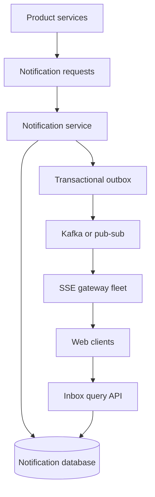

# Notification Center with Server-Sent Events

Server-Sent Events (SSE) are a good fit for a notification inbox because communication is predominantly server-to-browser. However, SSE should be the **live delivery mechanism**, not the durable notification store.

The core principle is:

> Persist the notification first; use SSE to tell an online browser that the inbox changed.

If an SSE event is lost, the notification remains in the database and can be recovered through the inbox query API.

## High-level architecture



A typical flow is:

1. Payment service emits `PAYMENT_PROCESSED`.
2. Notification service creates the user-facing notification.
3. The notification and outbox event are committed atomically.
4. The outbox event is published to Kafka or pub-sub.
5. An SSE gateway pushes an update to every active session belonging to the user.
6. The browser updates its inbox.

If the user is offline, steps 5 and 6 do not happen, but the notification remains in the database.

## Suggested data model

```sql
CREATE TABLE notifications (
    notification_id  UUID PRIMARY KEY,
    user_id           BIGINT NOT NULL,
    sequence_number   BIGINT NOT NULL,
    type              VARCHAR(50) NOT NULL,
    title             VARCHAR(200) NOT NULL,
    body              TEXT NOT NULL,
    metadata          JSONB,
    source_service    VARCHAR(50) NOT NULL,
    source_event_id   VARCHAR(200) NOT NULL,
    created_at        TIMESTAMP NOT NULL,
    read_at           TIMESTAMP,

    UNIQUE (user_id, sequence_number),
    UNIQUE (source_service, source_event_id)
);

CREATE INDEX notifications_by_user
ON notifications (
    user_id,
    sequence_number DESC
);
```

Important fields:

- `notification_id`: Stable client deduplication key.
- `sequence_number`: Monotonically increasing cursor for one user.
- `source_event_id`: Makes product-service retries idempotent.
- `read_at`: Stores whether the user has read the notification.

For example:

```text
Alice:
  sequence 101: Payment processed
  sequence 102: New partner-manager message
  sequence 103: New product feature
```

## API design

Retrieve the newest notifications:

```http
GET /v1/notifications?limit=50
```

Retrieve notifications newer than the client has seen:

```http
GET /v1/notifications?after_sequence=102
```

Paginate into older history:

```http
GET /v1/notifications?before_sequence=80&limit=50
```

Open the SSE stream:

```http
GET /v1/notifications/stream?after_sequence=102
```

Mark one notification as read:

```http
PUT /v1/notifications/{notificationId}/read
```

Because `PUT` expresses the desired state, repeating the request is naturally idempotent.

## Handling a dropped network connection

Suppose Alice has processed notifications through sequence 102. The notification service creates:

```text
sequence 103: Payment processed
```

Alice's connection drops just as the SSE gateway sends it.

The server does not know whether Alice's browser actually processed the message. A TCP write succeeding only means the data entered the network stack; it does not guarantee that the browser application handled it.

The recovery flow is:

```text
1. Alice's browser remembers lastSequence = 102.
2. The connection drops while sequence 103 is being delivered.
3. EventSource reconnects.
4. The browser sends Last-Event-ID: 102.
5. The server queries notifications where sequence_number > 102.
6. The server replays sequence 103.
7. Live streaming resumes.
```

The SSE event should contain its sequence number as the event ID:

```text
id: 103
event: notification
data: {"notificationId":"abc","title":"Payment processed"}
```

The browser's native `EventSource` automatically reconnects and can send:

```http
Last-Event-ID: 102
```

The server uses this as a replay cursor scoped to the authenticated user.

## Delivery semantics

The browser may receive sequence 103 before disconnecting but reconnect claiming 102. In that case, sequence 103 is delivered again.

The client must therefore deduplicate notifications:

```javascript
function handleNotification(notification) {
    if (renderedIds.has(notification.notificationId)) {
        return;
    }

    renderedIds.add(notification.notificationId);
    render(notification);
}
```

A stronger approach is to store client state by notification ID:

```javascript
notificationsById.set(
    notification.notificationId,
    notification
);
```

Replaying the same notification then becomes an upsert rather than a duplicate insertion.

The expected semantics are:

```text
Durable database: authoritative
SSE delivery: at least once
Client rendering: idempotent
```

## Why `Last-Event-ID` is not sufficient by itself

`Last-Event-ID` works well during an automatic reconnect of the same `EventSource`, but it is not a durable application acknowledgement.

Potential problems include:

- The browser tab reloads.
- The user opens the application on another device.
- The browser received the event but crashed before updating the UI.
- The browser discarded local state.
- The server retains replay events for only a limited period.

Always perform an authoritative inbox fetch when:

- The application starts.
- The tab becomes active after being suspended.
- The SSE connection reconnects after a long outage.
- The server says the replay cursor is too old.
- The client detects a sequence gap.

```javascript
async function synchronizeInbox() {
    const response = await fetch(
        `/v1/notifications?after_sequence=${lastSequence}`
    );

    const notifications = await response.json();

    for (const notification of notifications) {
        upsertNotification(notification);
        lastSequence = Math.max(
            lastSequence,
            notification.sequenceNumber
        );
    }
}
```

## Optional server-side cursors

The notification service does **not** have to store a separate delivery offset for every user. Because notifications are already durable and ordered, the client can provide its most recently processed sequence when it connects:

```http
GET /v1/notifications/stream?after_sequence=102
```

The server can then replay rows where `sequence_number > 102`. This stateless approach is usually the simplest default.

A server-side cursor becomes useful when the product must restore progress after browser storage is lost, distinguish progress across devices, or support explicit delivery acknowledgements. Store it per client or device rather than only per user, because a user's phone, laptop, and browser tabs can advance independently:

```sql
CREATE TABLE notification_client_cursors (
    user_id                      BIGINT NOT NULL,
    client_id                    VARCHAR(200) NOT NULL,
    last_acknowledged_sequence   BIGINT NOT NULL,
    updated_at                   TIMESTAMP NOT NULL,

    PRIMARY KEY (user_id, client_id)
);
```

Do not advance this cursor merely because the server successfully wrote an SSE event to the network. A successful write does not prove that the browser processed the event. If an acknowledged cursor is required, the browser should update it through a separate idempotent HTTP request after processing the notification:

```http
PUT /v1/notifications/cursors/{clientId}
Content-Type: application/json

{"lastAcknowledgedSequence":103}
```

The service should update the cursor monotonically:

```sql
UPDATE notification_client_cursors
SET last_acknowledged_sequence = GREATEST(
        last_acknowledged_sequence,
        :acknowledged_sequence
    ),
    updated_at = CURRENT_TIMESTAMP
WHERE user_id = :user_id
  AND client_id = :client_id;
```

Keep delivery progress separate from product-level read state:

- `last_acknowledged_sequence` means a particular client processed delivery through that point.
- `last_seen_sequence` means the user opened or viewed the inbox through that point.
- `read_at` means the user explicitly read a particular notification.
- A Kafka consumer offset means the backend consumer processed records from a Kafka partition; it is not a user's notification cursor.

For most notification centers, a good balance is:

1. Keep the notification database authoritative.
2. Persist the cursor in the browser for fast reconnection.
3. Optionally store acknowledged cursors per device when exact resume behavior is valuable.
4. Store user read or seen state on the server for unread counts and cross-device consistency.
5. Fall back to the inbox query API whenever a cursor is missing, expired, or invalid.

## Recommended pattern: SSE as an invalidation signal

Instead of sending the complete notification through SSE, send a small signal:

```text
id: 103
event: inbox_changed
data: {"latestSequence":103}
```

The browser then calls:

```http
GET /v1/notifications?after_sequence=102
```

Advantages:

- The inbox API remains authoritative.
- Lost SSE events do not lose notifications.
- Duplicate signals are harmless.
- Large notification payloads do not pass through connection gateways.
- Authorization and filtering remain centralized in the query service.
- The client can detect sequence gaps.

The SSE event may include a preview for immediate rendering, but the client should still reconcile with the query API.

## Avoiding the replay-to-live race

There is a subtle race during connection establishment:

```text
1. Client requests events after 102.
2. Server queries through 105.
3. Notification 106 is created.
4. Server subscribes to live events.
```

If event 106 occurs between steps 2 and 4, it can be missed.

A race-safe SSE gateway can:

1. Subscribe to the user's live pub-sub channel and temporarily buffer events.
2. Read the current high-water sequence, such as 105.
3. Replay database notifications `(102, 105]`.
4. Drain buffered events greater than 105.
5. Continue streaming live events.
6. Deduplicate by sequence number.

Periodic client reconciliation also repairs gaps, but the server-side replay-and-tail design provides cleaner real-time behavior.

## Transactional outbox

Avoid this unsafe dual write:

```text
1. Insert notification into database.
2. Publish notification to Kafka.
```

If the service crashes after step 1, the notification exists but online clients are not told about it.

Commit the notification and outbox event in one database transaction:

```sql
BEGIN;

INSERT INTO notifications (...);

INSERT INTO notification_outbox (
    event_id,
    user_id,
    notification_id,
    sequence_number,
    created_at
) VALUES (...);

COMMIT;
```

An outbox publisher reliably sends unpublished events to Kafka. If it publishes the same event twice, downstream consumers deduplicate by `event_id` or `notification_id`.

Even if publication is delayed, the notification remains available through the query API.

## Scaling the SSE gateway fleet

The SSE gateway fleet maintains long-lived browser connections:

```text
user 123:
  laptop connection -> gateway 4
  phone connection  -> gateway 8
  second tab        -> gateway 4
```

When an event arrives, every active connection for that user can receive it.

Connection gateways should:

- Authenticate the user when the stream opens.
- Maintain user-to-connection mappings.
- Consume notification events from Kafka or regional pub-sub.
- Send periodic heartbeat comments.
- Apply per-connection buffer limits.
- Close slow consumers.
- Drain connections during deployment.
- Allow reconnections to any gateway.
- Use the database cursor for replay instead of gateway-local memory.

Example heartbeat:

```text
: heartbeat

```

Heartbeats prevent load balancers and proxies from closing an apparently idle HTTP connection.

## Authentication considerations

The browser's native `EventSource` API does not conveniently support arbitrary authorization headers.

Common options are:

- Secure HTTP-only session cookies.
- A short-lived, narrowly scoped stream token.
- A fetch-based streaming client instead of native `EventSource`.

Avoid putting a long-lived bearer token in the URL because URLs may appear in logs and browser history.

## When WebSockets might be better

SSE is a good default for the inbox because:

- Traffic is mainly server-to-client.
- Automatic reconnect is built in.
- Event IDs support replay.
- Regular HTTP handles read acknowledgements and actions.

WebSockets may make more sense if the same connection also supports:

- High-frequency bidirectional chat.
- Typing indicators.
- Presence updates.
- Interactive collaboration.
- Real-time commands.

Even with WebSockets, the system still needs a durable database, replay cursor, deduplication, and reconciliation API. WebSockets do not solve lost notifications automatically.

## Recommended design

Use:

```text
Product services
    -> notification request topic or API
    -> notification service
    -> durable notification database + transactional outbox
    -> Kafka or pub-sub
    -> SSE gateway
    -> browser
```

On the browser:

1. Load the inbox through the REST API.
2. Store the highest processed sequence.
3. Open an SSE stream using that sequence.
4. Treat SSE events as inbox-change signals.
5. Fetch missing notifications from the REST API.
6. Deduplicate by `notification_id`.
7. Resynchronize after reconnect, page reload, and sequence gaps.

This provides fast live updates without making network connectivity part of the notification's durability guarantee.
